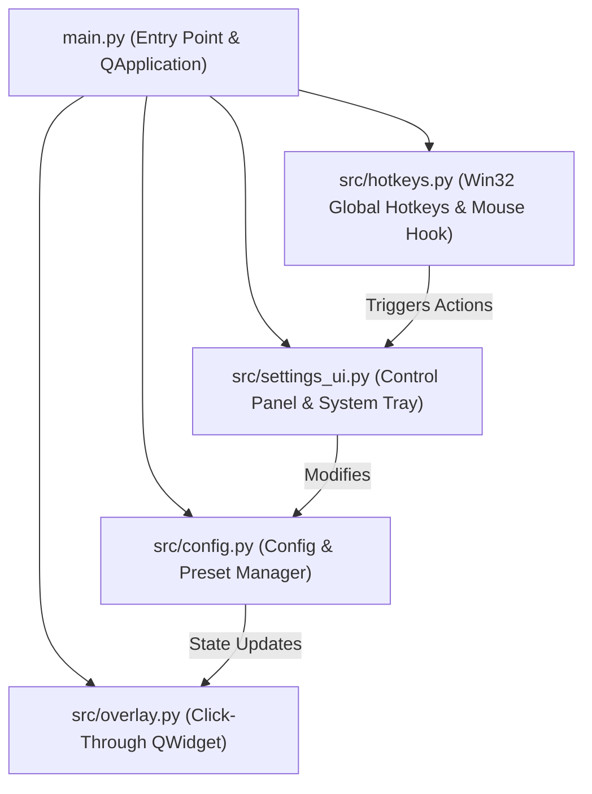

# Specification Document: Violence District (VD) Crosshair Overlay

## 1. Overview & Objectives
- **Project Name:** Violence District (VD) Crosshair Overlay
- **Target OS:** Windows 10 / Windows 11
- **Tech Stack:** Python 3.10+, `PyQt6`, Win32 API (`ctypes.windll.user32`)
- **Primary Objective:** Provide a zero-latency, hardware-accelerated, click-through desktop overlay for *Violence District* on Roblox, giving players customizable aiming reticles with high-contrast visibility and custom screen-offset calibration.

---

## 2. Architecture

### 2.1 Component Responsibilities
1. **`src/config.py` (`CrosshairConfig` & `ConfigManager`):**
   - Stores current settings and named presets in `config.json`.
   - Provides built-in default presets tailored for *Violence District* (*VD Precision Cross*, *Shotgun Spread Circle*, *Shift-Lock Dot*, *Tactical Chevron*).
2. **`src/overlay.py` (`CrosshairOverlay`):**
   - Full-screen transparent overlay widget positioned on the selected monitor.
   - Applies Win32 `WS_EX_LAYERED | WS_EX_TRANSPARENT | WS_EX_TOOLWINDOW` flags so mouse input passes straight through to Roblox and the overlay does not appear in Alt+Tab.
   - Renders anti-aliased vector shapes (`QPainter`) with optional high-contrast outlines and center dots.
3. **`src/settings_ui.py` (`SettingsWindow`):**
   - Modern dark gaming dashboard with real-time sliders, color swatches, preset selector, and an interactive 2D preview canvas.
   - Integrates with `QSystemTrayIcon` for background operation.
4. **`src/hotkeys.py` (`GlobalHotkeyManager`):**
   - Uses lightweight Win32 `GetAsyncKeyState` polling via a QTimer (no admin privileges or heavy third-party hooks required) to detect global hotkeys (`F8`, `F9`, `F10`, `Ctrl+Arrows`) and optional Right-Click ADS dynamic tightening.

---

## 3. Detailed Feature Specifications

### 3.1 Crosshair Shapes
| ID | Name | Description |
| :--- | :--- | :--- |
| `cross` | Classic Cross (`+`) | 4 orthogonal lines (Top, Bottom, Left, Right) separated by a center gap. |
| `t_cross` | T-Cross (`⊤`) | 3 orthogonal lines (Bottom, Left, Right) leaving upper sightline clear. |
| `dot` | Center Dot (`•`) | Single precision circle at the center point. |
| `circle` | Circle (`○`) | Hollow ring with configurable radius and thickness. |
| `circle_cross` | Circle + Cross (`⊕`) | Combination of hollow ring and 4-way crosshairs. |
| `chevron` | Chevron (`^`) | Upward-pointing angled V reticle (`45°` wings meeting at the center apex). |
| `x_mark` | X-Mark (`×`) | 4 diagonal lines at `45°` angles separated by a center gap. |

### 3.2 Visual & Visibility Parameters
- `shape` (`str`): Active shape ID.
- `color` (`str`): Hex color string (e.g., `#00FF66`).
- `opacity` (`int`): Alpha percentage (`10` to `100`).
- `size` (`int`): Primary length/radius in pixels (`2` to `60`).
- `thickness` (`int`): Line stroke width in pixels (`1` to `15`).
- `gap` (`int`): Distance from center point in pixels (`0` to `40`).
- `dot_enabled` (`bool`): Render a center dot in addition to the main shape.
- `dot_size` (`int`): Radius of the center dot (`1` to `12`).
- `outline_enabled` (`bool`): Draw high-contrast border around all elements.
- `outline_color` (`str`): Hex color for outline (default `#000000`).
- `outline_thickness` (`int`): Outline width in pixels (`1` to `5`).
- `ads_dynamic` (`bool`): Shrink gap by 35% while holding Right Mouse Button (ADS).

### 3.3 Position & Display Parameters
- `offset_x` (`int`): Horizontal pixel offset from monitor center (`-500` to `+500`).
- `offset_y` (`int`): Vertical pixel offset from monitor center (`-500` to `+500`).
- `monitor_index` (`int`): Target display index (`0` = Primary Monitor).
- `visible` (`bool`): Master overlay visibility state.
